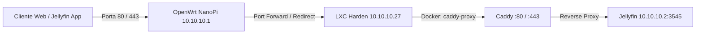

# 🔒 Caddy Reverse Proxy (Docker)

Serviço de Proxy Reverso e Gateway HTTPS baseado em Caddy para o Homelab, executado em container Docker dentro do LXC **`harden`** (`10.10.10.27`).

---

## 📐 Fluxo de Tráfego



---

## 🚀 Como Subir o Serviço no `harden`

### 1. Copiar a pasta para o container
A partir do seu PC (diretório `services`):
```bash
scp -r /home/juca/Documents/workspace/lab/services/caddy juca@10.10.10.27:~/
```

### 2. Iniciar o container Docker
No SSH do `harden` (`ssh juca@10.10.10.27`):
```bash
cd ~/caddy
docker compose up -d
```

### 3. Verificar o status e os logs
```bash
# Ver se o container está rodando:
docker compose ps

# Acompanhar logs em tempo real:
docker compose logs -f
```

---

## 🧪 Como Testar

1. **Teste local via IP (sem SSL)**:
   No terminal do seu PC:
   ```bash
   curl -I http://10.10.10.27
   ```
   *(Deve retornar `HTTP/1.1 200 OK` ou redirecionamento do Jellyfin se o container `media` no 10.10.10.2:3545 estiver online).*

2. **Recarregar o Caddyfile sem reiniciar o container**:
   Sempre que editar o `Caddyfile`, aplique as mudanças instantaneamente com:
   ```bash
   docker compose exec caddy caddy reload --config /etc/caddy/Caddyfile
   ```

---

## ⚙️ Dica de Recursos no LXC (`NanoPi R3S`)

O container Caddy está limitado a **64 MB de RAM** no `docker-compose.yaml`.
Junto com o daemon do Docker no Alpine, o consumo médio fica em **~85 MB a 95 MB**.

Caso queira folga adicional, você pode ajustar o limite de memória do LXC no roteador (`/etc/lxc/harden/config`):
```text
lxc.cgroup2.memory.max = 256M
```
