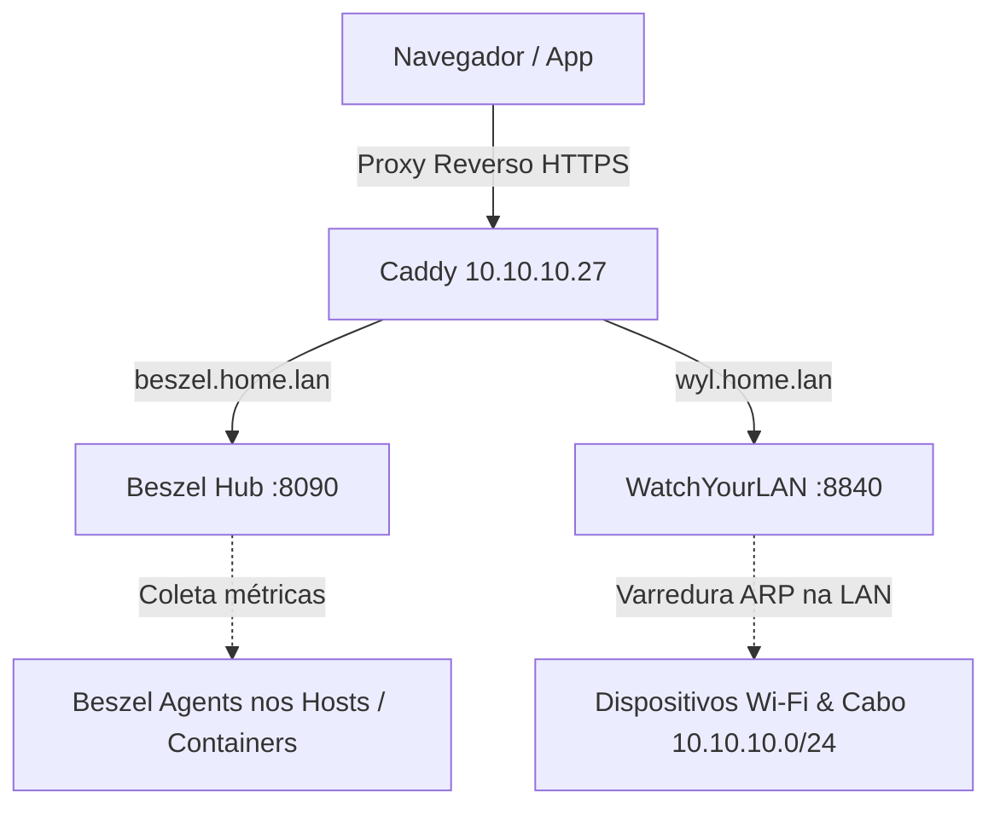

# 📊 Monitoramento & Auditoria de Rede: Beszel + WatchYourLAN

Stack unificada de Métricas em Tempo Real e Detecção de Dispositivos na LAN para o Homelab, executada dentro do LXC **`monitor`** (`10.10.10.28`) no **NanoPi R3S**.

---

## 📐 Serviços Inclusos



---

## 📁 Estrutura de Arquivos no LXC (`~/workspace/services/monitor/`)

```text
monitor/
├── docker-compose.yaml     # Orquestração do Beszel Hub + Beszel Agent + WatchYourLAN
├── README.md               # Documentação e instruções de operação
└── data/
    ├── beszel/             # Banco de dados PocketBase SQLite (métricas e chaves SSH)
    └── watchyourlan/       # Histórico de dispositivos descobertos
```

---

## 🖥️ Como Adicionar os Sistemas no Beszel Hub

O Beszel funciona com a arquitetura **Hub + Agent**. O Hub apenas centraliza os dados; cada máquina ou container roda um **Agent** ultraleve (~8MB RAM):

1. Acesse `https://beszel.home.lan` no navegador.
2. No canto superior direito, clique em **`+ Add System`**.
3. Cadastre os sistemas desejados:

### Sistema 1: NanoPi R3S (Host / Hardware Real)
* **Name:** `NanoPi R3S`
* **Host / IP:** `10.10.10.1`
* **Port:** `45876`
* *Métricas coletadas:* Temperatura real do SoC Rockchip RK3568, uso dos 4 núcleos da CPU, uso total da RAM (2GB), tráfego real da WAN (`pppoe-wan`) e Wi-Fi/LAN, espaço da eMMC.
* *Serviço nativo:* `/etc/init.d/beszel-agent` (OpenWrt procd em RAM `/var/lib`, sem escrita na eMMC).

### Sistema 2: LXC Monitor (Containers Docker)
* **Name:** `LXC Monitor`
* **Host / IP:** `10.10.10.28`
* **Port:** `45876`
* *Métricas coletadas:* CPU, RAM e status dos containers Docker individuais (`beszel-hub`, `watchyourlan`, `beszel-agent`).

### Sistema 3: Cudy (Roteador / AP Wi-Fi Mesh @ OpenWrt)
* **Name:** `Cudy`
* **Host / IP:** `10.10.10.45`
* **Port:** `45876`
* *Métricas coletadas:* Temperatura do SoC MediaTek Filogic e dos rádios Wi-Fi (MT7915 2.4G/5G), tráfego das interfaces Mesh/AP (`phy1-mesh0`, `phy1-ap0`), CPU dual-core e RAM (240MB).
* *Otimização de Flash:* O executável do agente roda 100% em RAM (`/tmp/beszel-agent`) sem ocupar os 3.4 MB da partição `/overlay` da flash ROM. A inicialização é gerenciada pelo `/etc/init.d/beszel-agent` via procd.

Após salvar, clique no **ícone de cubo** (Systems) no topo para ver os gráficos ao vivo!

---

## 🚀 Como Subir o Serviço no `monitor` (`10.10.10.28`)

### 1. Sincronizar os arquivos para o container:
A partir do seu PC:
```bash
rsync -avz --delete /media/juca/SharedData1/workspace/services/monitor/ juca@10.10.10.28:~/workspace/services/monitor/
```

### 2. Iniciar os containers no `monitor`:
No SSH do `monitor` (`ssh juca@10.10.10.28`):
```bash
cd ~/workspace/services/monitor
docker compose up -d
```

### 3. Verificar o status:
```bash
docker compose ps
```
Ambos os containers (`beszel-hub` e `watchyourlan`) devem estar com status **Up**.

---

## 🌐 URLs de Acesso Local (via Caddy)

* **Beszel Hub (Dashboard de Métricas):** `https://beszel.home.lan` (ou `http://10.10.10.28:8090`)
* **WatchYourLAN (Scanner de Rede):** `https://wyl.home.lan` (ou `http://10.10.10.28:8840`)

---

## 🛡️ Otimizações de Recursos para o NanoPi R3S

* **Consumo de Memória:** Total combinado de apenas **~50 MB a 80 MB de RAM**.
* **Preservação de eMMC:** Logs do Docker limitados a `max-size: 3m` e `max-file: 2` (máximo 6 MB por container).
* **Varredura Leve:** WatchYourLAN configurado com timeout de 120s para não saturar a rede Wi-Fi nem consumir ciclos extras de CPU.

