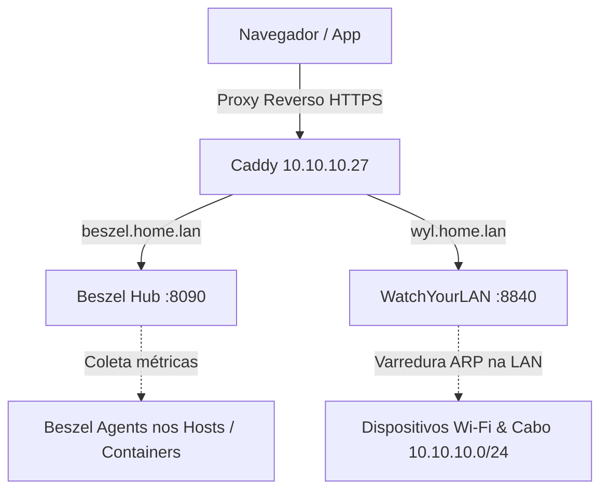

# 📊 Monitoramento & Auditoria de Rede: Beszel + WatchYourLAN

Stack unificada de Métricas em Tempo Real e Detecção de Dispositivos na LAN para o Homelab, executada dentro do LXC **`monitor`** (`10.10.10.28`) no **NanoPi R3S**.

---

## 📐 Serviços Inclusos



---

## 📁 Estrutura de Arquivos no LXC (`~/workspace/services/monitor/`)

```text
monitor/
├── docker-compose.yaml     # Orquestração do Beszel Hub + WatchYourLAN
├── README.md               # Documentação e instruções de operação
└── data/
    ├── beszel/             # Banco de dados PocketBase SQLite (métricas)
    └── watchyourlan/       # Histórico de dispositivos descobertos
```

---

## 🚀 Como Subir o Serviço no `monitor` (`10.10.10.28`)

### 1. Sincronizar os arquivos para o container:
A partir do seu PC:
```bash
rsync -avz --delete /media/juca/SharedData1/workspace/services/monitor/ juca@10.10.10.28:~/workspace/services/monitor/
```

### 2. Iniciar os containers no `monitor`:
No SSH do `monitor` (`ssh juca@10.10.10.28`):
```bash
cd ~/workspace/services/monitor
docker compose up -d
```

### 3. Verificar o status:
```bash
docker compose ps
```
Ambos os containers (`beszel-hub` e `watchyourlan`) devem estar com status **Up**.

---

## 🌐 URLs de Acesso Local (via Caddy)

* **Beszel Hub (Dashboard de Métricas):** `https://beszel.home.lan` (ou `http://10.10.10.28:8090`)
* **WatchYourLAN (Scanner de Rede):** `https://wyl.home.lan` (ou `http://10.10.10.28:8840`)

---

## 🛡️ Otimizações de Recursos para o NanoPi R3S

* **Consumo de Memória:** Total combinado de apenas **~50 MB a 80 MB de RAM**.
* **Preservação de eMMC:** Logs do Docker limitados a `max-size: 3m` e `max-file: 2` (máximo 6 MB por container).
* **Varredura Leve:** WatchYourLAN configurado com timeout de 120s para não saturar a rede Wi-Fi nem consumir ciclos extras de CPU.

